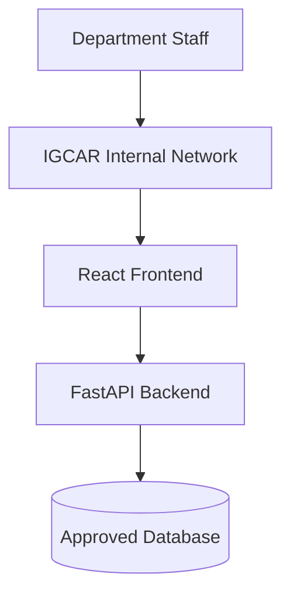

# MAAM – Electrical Equipment Management System

## 1. Project Overview

MAAM is a web-based Electrical Equipment Management System proof of concept (POC) intended for department-level use at the Indira Gandhi Centre for Atomic Research (IGCAR).

The application provides a common interface for managing substation locations, electrical equipment information, inventory, and reports.

> **Current status:** POC. Some pages use sample data and browser-side state. Database integration, production authentication, security review, and hosting approval are required before shared operational use.

## 2. Main Features

- Login page
- Dashboard
- Substation locations
- Equipment listing for each substation
- Equipment details, including:
  - Nameplate details
  - Equipment history
  - Oil testing
  - Dissolved Gas Analysis (DGA)
  - Winding tests
  - Electrical readings
  - Condition assessment
- Inventory
- Reports
- Common navigation and page layout

The exact functionality depends on the current code. Sample records are not actual IGCAR equipment data.

## 3. Technology Stack

| Layer | Technology |
|---|---|
| Frontend | React |
| Development/build tool | Vite |
| Routing | React Router |
| Backend | Python FastAPI |
| API communication | Fetch API via `frontend/src/services/api.js` |
| Database | To be selected for deployment |
| Version control | Git and GitHub |

## 4. System Architecture



The React frontend provides the user interface. It communicates with the FastAPI backend through HTTP APIs. The backend handles validation and application logic and communicates with the database.

## 5. Project Structure

The following is the intended organisation. Actual files in the repository may vary.

```text
MAAM/
├── frontend/
│   ├── public/
│   ├── src/
│   │   ├── components/
│   │   │   ├── Header.jsx
│   │   │   ├── Sidebar.jsx
│   │   │   └── StatCard.jsx
│   │   ├── layouts/
│   │   │   └── MainLayout.jsx
│   │   ├── pages/
│   │   │   ├── Login.jsx
│   │   │   ├── Dashboard.jsx
│   │   │   ├── SubstationLocations.jsx
│   │   │   ├── LocationEquipment.jsx
│   │   │   ├── EquipmentDetails.jsx
│   │   │   ├── Inventory.jsx
│   │   │   └── Reports.jsx
│   │   ├── services/
│   │   │   └── api.js
│   │   ├── styles/
│   │   ├── App.jsx
│   │   └── main.jsx
│   └── package.json
├── backend/
│   ├── main.py
│   └── requirements.txt
├── .gitignore
├── README.md
└── architecture.md
```

This is a reference structure, not a requirement to create every folder immediately. Keep the files that exist and update this section as the project evolves.

## 6. Prerequisites

Install:

- Python 3
- Node.js and npm
- Git
- Visual Studio Code (recommended)

Check the installations:

```bash
python --version
node --version
npm --version
git --version
```

## 7. Run Locally

Run the frontend and backend in two separate terminals.

### 7.1 Backend

From the project root:

```bash
cd backend
```

If `requirements.txt` exists, install dependencies:

```bash
pip install -r requirements.txt
```

Start FastAPI:

```bash
python -m uvicorn main:app --reload
```

Backend address: http://127.0.0.1:8000

Interactive API documentation: http://127.0.0.1:8000/docs

Keep this terminal running.

### 7.2 Frontend

Open a second terminal from the project root:

```bash
cd frontend
npm install
npm run dev
```

Open the URL printed by Vite. It is normally:

http://localhost:5173/

Keep this terminal running too.

### 7.3 Stop the services

Press `Ctrl + C` in each terminal.

## 8. Frontend–Backend Communication

The shared API service is located at:

```text
frontend/src/services/api.js
```

Frontend pages should use the shared API functions rather than repeating fetch configuration.

The local development backend address is normally:

```text
http://localhost:8000
```

For deployment, configure the frontend to use the approved internal API address. Do not assume localhost URLs will work for other staff computers.

## 9. Main Application Routes

| Page | Route |
|---|---|
| Login | `/` |
| Dashboard | `/dashboard` |
| Substation Locations | `/substations` |
| Equipment for a location | `/substations/:locationId/equipment` |
| Equipment Details | `/substations/:locationId/equipment/:equipmentId` |
| Inventory | `/inventory` |
| Reports | `/reports` |

Route definitions are maintained in `frontend/src/App.jsx`.

## 10. Current POC Limitations

Before using the application with multiple staff members or operational records:

- Replace demonstration login logic with approved authentication.
- Do not rely on a browser-side login flag as proof of authentication.
- Store passwords only as secure hashes if application-managed accounts are approved.
- Add backend authentication and role-based authorisation.
- Move sample data and browser-only state into a database-backed API.
- Add input validation and appropriate error handling.
- Keep secrets and credentials out of source code.
- Configure logging, backups, recovery, and monitoring.
- Complete IGCAR hosting and security approvals.

## 11. Planned Multiple-User Login

A future version may support individual accounts and role-based access.

| Role | Intended access |
|---|---|
| Administrator | Manage user accounts and authorised application records |
| Engineer / Staff | View and update permitted equipment and inspection information |
| Viewer | View permitted information without editing |

Before implementing application-managed passwords, check whether IGCAR provides an approved LDAP, Active Directory, or Single Sign-On (SSO) service. Prefer an approved institutional identity service when available.

If separate application accounts are approved, a users table may contain:

- User ID
- Full name
- Username
- Password hash (never a plain-text password)
- Role
- Account status
- Creation timestamp

Initially, user creation should be restricted to an authorised administrator unless the department approves another process.

## 12. Git and GitHub

If Git has not already been initialised:

```bash
git init
```

Check changes:

```bash
git status
```

Add and commit:

```bash
git add .
git commit -m "Update MAAM application"
```

Push to the configured GitHub remote:

```bash
git push
```

Ensure `.gitignore` excludes generated dependencies and Python cache files. Never commit passwords, API secrets, private keys, or other credentials.

## 13. Department-Level IGCAR Hosting

Proposed hosting model:

1. Department users access the application through the IGCAR internal network.
2. An IGCAR-approved internal server or virtual machine hosts the application.
3. React is built for production and served by an approved web server.
4. FastAPI runs as a managed backend service, behind an approved reverse proxy where required.
5. Application records are stored in an approved database.
6. Access control, HTTPS, firewall rules, backups, logging, and monitoring follow IGCAR requirements.

Contact the IGCAR Computer Division or authorised IT team to confirm:

- Availability of an internal application server or private-cloud virtual machine.
- Approved operating system and software versions.
- Approved database platform.
- Internal hostname and network access arrangements.
- HTTPS certificate and reverse-proxy requirements.
- Firewall and security review requirements.
- Backup, monitoring, maintenance, and support responsibilities.

Do not expose the development server to the wider network or public internet without formal approval. Do not use sensitive operational data in the POC until the required approvals and protections are in place.

## 14. Related Documentation

- `architecture.md` – Application architecture, components, workflows, and diagrams.
- `IGCAR_Department_Deployment_Architecture.md` – Proposed department-level hosting architecture and deployment considerations.

Update this README as features, API endpoints, database configuration, and deployment procedures are finalised.
