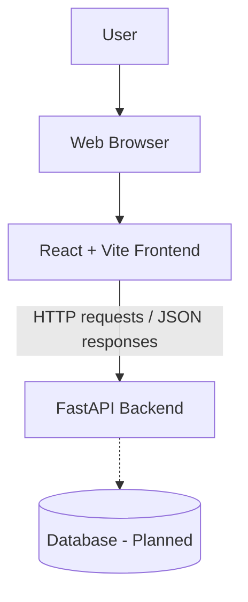
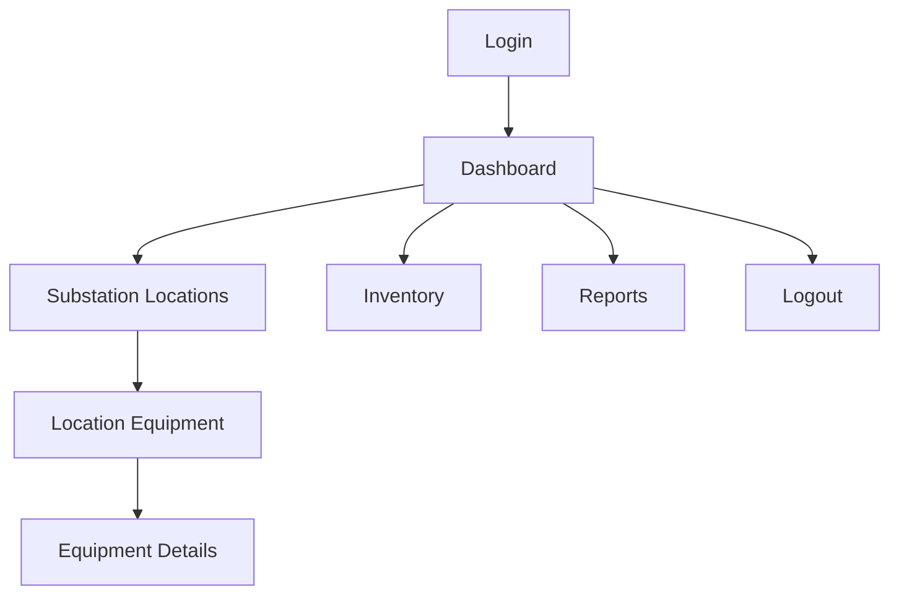
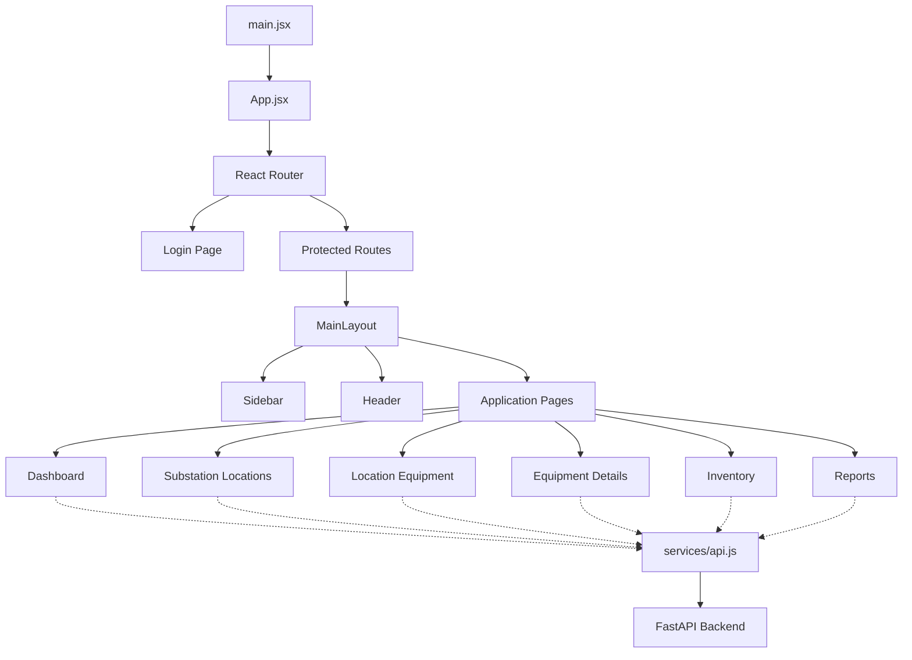
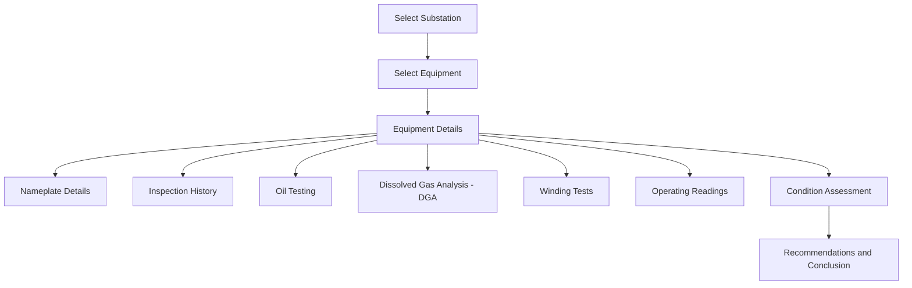

# IGCAR Electrical Equipment Management System

## Project Architecture

**Project type:** Proof of Concept (POC)\
**Frontend:** React + Vite\
**Backend:** Python + FastAPI\
**Purpose:** Demonstrate management of electrical equipment,
substations, inspection records, test results, inventory and reports.

------------------------------------------------------------------------

## 1. System Overview

The application follows a frontend--backend architecture.

-   **Frontend (React):** Displays the user interface, handles
    navigation, forms, filters and user interactions.
-   **Backend (FastAPI):** Exposes API endpoints and processes requests
    from the frontend.
-   **Database (future enhancement):** Stores users, substations,
    equipment, test records, inventory and reports persistently.

During the current POC, some pages use sample data held in the React
application. Those records are not yet stored in the backend or shared
between computers.

``` text
User
  |
  v
Web Browser
  |
  v
React + Vite Frontend
  |
  | HTTP requests (JSON)
  v
FastAPI Backend
  |
  v
Database (planned)
```

## 2. Technology Stack

  -----------------------------------------------------------------------
  Layer                   Technology              Responsibility
  ----------------------- ----------------------- -----------------------
  Frontend                React                   User interface and page
                                                  components

  Frontend tooling        Vite                    Development server and
                                                  frontend build

  Routing                 React Router            Navigation between
                                                  application pages

  Styling                 CSS                     Layout, colours,
                                                  tables, forms and
                                                  responsive design

  API communication       JavaScript Fetch API    Calls backend endpoints
                          via `api.js`            

  Backend                 Python + FastAPI        API routes and
                                                  application logic

  API testing             FastAPI Swagger UI      Test API endpoints at
                                                  `/docs`

  Version control         Git and GitHub          Source-code management
  -----------------------------------------------------------------------

A database can be added when persistent storage is required. PostgreSQL
is a suitable option for a later multi-user deployment; SQLite may be
sufficient for a small local demonstration.

## 3. Proposed Project Folder Structure

``` text
MAAM/
|
|-- frontend/
|   |-- public/
|   |-- src/
|   |   |-- components/
|   |   |   |-- Sidebar.jsx
|   |   |   |-- Header.jsx
|   |   |   |-- StatCard.jsx
|   |   |
|   |   |-- layouts/
|   |   |   |-- MainLayout.jsx
|   |   |
|   |   |-- pages/
|   |   |   |-- Login.jsx
|   |   |   |-- Dashboard.jsx
|   |   |   |-- SubstationLocations.jsx
|   |   |   |-- LocationEquipment.jsx
|   |   |   |-- EquipmentDetails.jsx
|   |   |   |-- Inventory.jsx
|   |   |   |-- Reports.jsx
|   |   |
|   |   |-- services/
|   |   |   |-- api.js
|   |   |
|   |   |-- styles/
|   |   |   |-- global.css
|   |   |   |-- layout.css
|   |   |   |-- login.css
|   |   |   |-- dashboard.css
|   |   |   |-- substation.css
|   |   |   |-- equipment.css
|   |   |   |-- inventory.css
|   |   |   |-- reports.css
|   |   |
|   |   |-- App.jsx
|   |   |-- main.jsx
|   |
|   |-- index.html
|   |-- package.json
|   |-- package-lock.json
|
|-- backend/
|   |-- main.py
|   |-- requirements.txt
|
|-- .gitignore
|-- README.md
|-- architecture.md
```

This is the intended logical structure. Keep files that already exist in
their current locations; create optional folders such as `styles/` only
as the project is reorganised.

### 3.1 Frontend folders

  -----------------------------------------------------------------------
  Folder / file                       Responsibility
  ----------------------------------- -----------------------------------
  `components/`                       Reusable interface elements such as
                                      sidebar, header and statistic cards

  `layouts/`                          Shared page structure surrounding
                                      routed pages

  `pages/`                            Main screens of the application

  `services/api.js`                   Common functions for communicating
                                      with FastAPI

  `styles/`                           CSS organised by common layout,
                                      component or page

  `App.jsx`                           Route definitions and
                                      protected-route handling

  `main.jsx`                          React application entry point and
                                      global CSS imports
  -----------------------------------------------------------------------

`hooks/` and `utils/` may be introduced later when reusable React hooks
or helper functions are actually needed. They are not mandatory folders.

### 3.2 Backend files

  -----------------------------------------------------------------------
  File                                Responsibility
  ----------------------------------- -----------------------------------
  `main.py`                           Creates the FastAPI application and
                                      defines API endpoints

  `requirements.txt`                  Lists Python packages required to
                                      run the backend
  -----------------------------------------------------------------------

As the backend grows, its routes, schemas, services and database models
can be separated into dedicated modules.

## 4. Application Navigation

The main application flow is:

``` text
Login
  |
  v
Dashboard
  |
  +---- Substation Locations
  |          |
  |          +---- Select a Substation
  |                     |
  |                     v
  |               Location Equipment
  |                     |
  |                     +---- Select Equipment
  |                                |
  |                                v
  |                         Equipment Details
  |                                |
  |                                +---- Nameplate
  |                                +---- History
  |                                +---- Oil Testing
  |                                +---- DGA
  |                                +---- Winding
  |                                +---- Readings
  |                                +---- Assessment
  |
  +---- Inventory
  |
  +---- Reports
  |
  +---- Logout
```

The sidebar provides navigation to Dashboard, Substation Locations,
Inventory and Reports. Equipment details are reached through the
selected substation and equipment rather than being a separate top-level
sidebar item.

## 5. Frontend Route Design

The React Router configuration follows this route plan:

  ---------------------------------------------------------------------------------------------------
  Route                                               Page                    Access
  --------------------------------------------------- ----------------------- -----------------------
  `/`                                                 Login                   Public

  `/dashboard`                                        Dashboard               Login required

  `/substations`                                      Substation Locations    Login required

  `/substations/:locationId/equipment`                Equipment at selected   Login required
                                                      location                

  `/substations/:locationId/equipment/:equipmentId`   Equipment Details       Login required

  `/inventory`                                        Inventory               Login required

  `/reports`                                          Reports                 Login required
  ---------------------------------------------------------------------------------------------------

`MainLayout.jsx` provides the common sidebar, header, page area and
footer for authenticated pages. `ProtectedRoute` prevents
unauthenticated users from opening protected routes.

## 6. API Communication

React pages should call the backend through the shared API service
rather than repeating `fetch()` configuration in every page.

The API service centralises: - Backend base URL - HTTP request
configuration - JSON request and response handling - Error handling

The service can expose reusable methods for:

  HTTP method   Typical purpose                    Example
  ------------- ---------------------------------- --------------------------
  GET           Retrieve records                   `GET /substations`
  POST          Create a record or submit data     `POST /substations`
  PUT           Replace/update a complete record   `PUT /equipment/TR-1`
  PATCH         Update selected fields             `PATCH /equipment/TR-1`
  DELETE        Delete a record                    `DELETE /equipment/TR-1`

Example frontend usage:

``` javascript
import { getData, postData } from "../services/api.js";

// Retrieve substations
const substations = await getData("/substations");

// Create a substation
const result = await postData("/substations", {
  name: "PDC-3"
});
```

These endpoint examples describe the intended API design. They will work
only after matching endpoints have been implemented in the FastAPI
backend.

## 7. Backend Design

FastAPI receives HTTP requests from the React frontend and returns
responses, usually in JSON format.

Example current login endpoint:

``` text
POST /auth/login
```

The login endpoint checks the submitted credentials and returns a
success response or an authentication error.

The backend must allow requests from the frontend origin through CORS
configuration during development. For example:

``` python
allow_origins=["http://localhost:5173"]
```

When the frontend is hosted at a different address, configure the
allowed origin accordingly.

The FastAPI interactive API documentation is available at:

``` text
http://127.0.0.1:8000/docs
```

## 8. Functional Scope and Current POC Status

The following distinction is important when demonstrating the POC.

  -----------------------------------------------------------------------
  Module                  POC behaviour           Future backend/database
                                                  integration
  ----------------------- ----------------------- -----------------------
  Login                   Connected to FastAPI    Secure user accounts,
                          login endpoint          password hashing and
                                                  session/token handling

  Dashboard               Displays application    Load live counts and
                          summary/sample          status from database
                          information             

  Substation Locations    Displays sample         Store and retrieve
                          locations; additions    substations
                          may be local React      
                          state                   

  Location Equipment      Displays sample         Store and retrieve
                          equipment; additions    equipment by substation
                          may be local React      
                          state                   

  Equipment Details       Displays equipment      Save and retrieve
                          sections and            nameplate, test and
                          placeholder/sample      assessment records
                          values                  

  Inventory               Uses sample records and Live inventory, updates
                          frontend filters        and stock tracking

  Reports                 Uses sample report      Generate, store and
                          records and frontend    retrieve reports
                          filters                 
  -----------------------------------------------------------------------

**Current limitation:** React state and hardcoded sample arrays are
temporary. They can reset when the page is refreshed and are not
automatically shared with another user's computer. Persistent multi-user
data requires backend endpoints and a database.

## 9. Equipment Information Model (Planned)

The equipment module is intended to organise the following information:

1.  Equipment identity and nameplate details
2.  Inspection and maintenance history
3.  Transformer oil test results
4.  Dissolved Gas Analysis (DGA)
5.  Winding test results, including HV-LV, HV-E and LV-E measurements
    where applicable
6.  Operating readings such as load, temperature, voltage and current
7.  Condition assessment
8.  Recommendations and conclusions

The exact fields, units, acceptance limits and applicable standards
should be confirmed with the responsible electrical engineering team
before implementing validation or automated assessment.

## 10. Local Development and Execution

Two terminals are used during local development.

### Backend terminal

``` bash
cd backend
python -m pip install -r requirements.txt
python -m uvicorn main:app --reload
```

Backend address:

``` text
http://127.0.0.1:8000
```

API documentation:

``` text
http://127.0.0.1:8000/docs
```

### Frontend terminal

``` bash
cd frontend
npm install
npm run dev
```

Frontend address:

``` text
http://localhost:5173
```

Keep both development servers running while using the application.

## 11. Configuration and Deployment Considerations

-   Keep the backend URL in one place in `frontend/src/services/api.js`.
-   Configure CORS for the actual frontend origin.
-   Do not commit secrets, real passwords or private environment files
    to GitHub.
-   Use environment-specific configuration for development and
    deployment.
-   For a shared deployment, host the frontend and backend on an
    accessible server and connect both to a persistent database.
-   Use HTTPS and proper authentication before exposing the application
    beyond a controlled demonstration.
-   Do not use the current hardcoded demonstration login as production
    authentication.

## 12. Git and Project Sharing

The `.gitignore` file should exclude generated dependencies and Python
cache files:

``` gitignore
# Node.js dependencies
node_modules/
frontend/node_modules/
backend/node_modules/

# Python cache
__pycache__/
*.pyc
```

Include source code and dependency manifests such as `package.json`,
`package-lock.json` and `requirements.txt` when sharing the project. The
recipient installs dependencies on their own operating system before
running it.

------------------------------------------------------------------------

## 13. Future Development Roadmap

1.  Finalise the frontend screens and navigation.
2.  Define backend API endpoints for substations and equipment.
3.  Select and configure a database.
4.  Connect Inventory and Reports to backend data.
5.  Persist equipment nameplate, inspection and test records.
6.  Implement secure authentication and user roles.
7.  Add report export and backup facilities.
8.  Test the application on Windows, macOS and Linux.
9.  Deploy to a server for access by multiple authorised users.

------------------------------------------------------------------------

**Document note:** This architecture describes the current React +
FastAPI POC and a practical path to a database-backed application.
Sections marked as planned or future are not claims that those features
are already implemented.


---

## 14. Architecture Diagrams

The following diagrams summarise the system structure, page navigation, frontend organisation and equipment information flow. GitHub supports Mermaid diagrams in Markdown, so these diagrams can be viewed directly in the repository.

### 14.1 Overall System Architecture

This diagram shows how a user accesses the React application and how the frontend communicates with the FastAPI backend. The database is a planned enhancement.



### 14.2 Application Navigation Flow

This diagram shows the main navigation path through the application. Equipment details are accessed by selecting a substation and then an equipment item.



### 14.3 Frontend Architecture

This diagram shows the relationship between the application entry point, routing, shared layout, pages, reusable components and the API service.



The dotted connections indicate pages that can use the shared API service when their data is connected to backend endpoints. Pages currently using sample data do not necessarily make API calls.

### 14.4 Equipment Information Flow

This diagram shows the information sections planned for each selected equipment item.



The exact test parameters, units, acceptance limits and applicable standards should be confirmed by the responsible electrical engineering team before implementing automated assessment.
